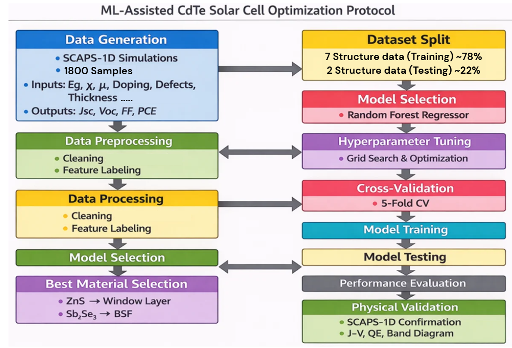

<h1 align="center">Fabrication and machine learning-predicted configuration for efficient CdTe solar cell</h1>

<p align="center">
Ahnaf Tahmid Abir<sup>1</sup>, Jaker Hossain<sup>1*</sup>, Md. Alamin Hossain Pappu<sup>1</sup>, and Mamunur Rashid Talukder<sup>2*</sup>
</p>

<p align="center">
<i><sup>1</sup>Photonics &amp; Advanced Materials Laboratory, Department of Electrical and Electronic Engineering, University of Rajshahi, Rajshahi 6205, Bangladesh.</i><br>
<i><sup>2</sup>Plasma Engineering Laboratory, Department of Electrical and Electronic Engineering, University of Rajshahi, Rajshahi 6205, Bangladesh.</i>
</p>

<p align="center">*Corresponding authors</p>

<p align="center"><b>Code and dataset for ML-assisted optimization of CdTe solar cells (SCAPS-1D)</b></p>

---

## Overview

This repository contains the SCAPS-1D-generated dataset and the machine learning notebooks used to predict the photovoltaic performance (**Voc, Jsc, FF, PCE**) of CdTe solar cells from the material and layer parameters of the window layer, absorber, and back surface field (BSF) layer. The trained models are then used to compare candidate window/BSF materials and identify the best-performing configuration.

**Key result:** ZnS as the window layer and Sb₂Se₃ as the BSF layer gave the best configuration, which was then confirmed by SCAPS-1D (J-V, QE, band diagram).

## Methodology



1. **Data generation:** 1800 samples simulated in SCAPS-1D (inputs: bandgap, electron affinity, mobility, doping, defect density, thickness, etc.; outputs: Jsc, Voc, FF, PCE).
2. **Preprocessing:** data cleaning and feature labeling.
3. **Dataset split (by structure):** 7 structures for training (~78%) and 2 structures for testing (~22%).
4. **Model selection and hyperparameter tuning:** grid search with 5-fold cross-validation.
5. **Training, testing, and performance evaluation.**
6. **Best material selection:** optimization over window and BSF materials using the trained models, giving ZnS (window) and Sb₂Se₃ (BSF).
7. **Physical validation:** SCAPS-1D confirmation (J-V, QE, band diagram).

## Repository Structure

```
.
├── data/
│   └── All_Structures_Combined.csv        # Dataset (rename extension if .xlsx)
├── notebooks/
│   ├── Hyper_parameters_New_Dataset.ipynb # Hyperparameter tuning of the models
│   ├── solarcell_ML_Models_final.ipynb    # Model training/comparison, feature importance, best-structure search
│   └── optimization.ipynb                 # Optimization/selection of the window and BSF materials
├── images/
│   └── Methodology.png
├── requirements.txt
├── LICENSE
└── README.md
```

## Dataset: `All_Structures_Combined`

Each row is one SCAPS-1D simulation of a Window / Absorber / BSF structure.

### Column naming

| Prefix | Layer |
|--------|-------|
| `W_` | Window layer |
| `A_` | Absorber layer (CdTe) |
| `B_` | BSF (back surface field) layer |

| Suffix | Parameter | Unit (SCAPS-1D) |
|--------|-----------|------|
| `Thickness` | Layer thickness | µm |
| `Eg` | Bandgap | eV |
| `Ea` | Electron affinity (χ) | eV |
| `Dp` | Dielectric permittivity (relative) | – |
| `Nc` | Effective density of states, conduction band | cm⁻³ |
| `Nv` | Effective density of states, valence band | cm⁻³ |
| `Ue` | Electron mobility | cm²/V·s |
| `Uh` | Hole mobility | cm²/V·s |
| `Na` | Doping density | cm⁻³ |
| `dd` | Defect density (Nt) | cm⁻³ |

> **Note:** `W_Na` is the doping density of the window layer, which is n-type, so it is physically a **donor density (Nd)**. The column keeps the name `W_Na` for consistency with the other layers.

### Columns

- **Identifiers:** `Structure`, `Window` (window material), `BSF` (BSF material)
- **Window layer inputs:** `W_Thickness`, `W_Eg`, `W_Ea`, `W_Dp`, `W_Nc`, `W_Nv`, `W_Ue`, `W_Uh`, `W_Na`, `W_dd`
- **Absorber inputs:** `A_Thickness`, `A_Eg`, `A_Ea`, `A_Dp`, `A_Nc`, `A_Nv`, `A_Ue`, `A_Uh`, `A_Na`, `A_dd`
- **BSF inputs:** `B_Thickness`, `B_Eg`, `B_Ea`, `B_Dp`, `B_Nc`, `B_Nv`, `B_Ue`, `B_Uh`, `B_Na`, `B_dd`
- **Targets (outputs):** `Voc` (V), `Jsc` (mA/cm²), `FF` (%), `PCE` (%)

## Notebooks

| Notebook | Description |
|----------|-------------|
| [`Hyper_parameters_New_Dataset.ipynb`](notebooks/Hyper_parameters_New_Dataset.ipynb) | Hyperparameter tuning of the ML models (grid search with 5-fold cross-validation). |
| [`solarcell_ML_Models_final.ipynb`](notebooks/solarcell_ML_Models_final.ipynb) | Training and comparison of the models, feature importance extraction, and identification of the best structure. |
| [`optimization.ipynb`](notebooks/optimization.ipynb) | Optimization technique for selecting the window and BSF materials. |

Suggested order: `Hyper_parameters_New_Dataset.ipynb`, then `solarcell_ML_Models_final.ipynb`, then `optimization.ipynb`.

## Getting Started

### 1. Clone the repository

```bash
git clone https://github.com/AHP18/CdTe-SolarCell-ML-SCAPS.git
cd CdTe-SolarCell-ML-SCAPS
```

### 2. Install dependencies

```bash
pip install -r requirements.txt
```

### 3. Launch Jupyter

```bash
jupyter notebook
```

Open the notebooks inside `notebooks/`. If a notebook loads the data with a path such as `All_Structures_Combined.csv`, update it to `../data/All_Structures_Combined.csv`.

You can also open the notebooks in Google Colab by uploading them with the dataset.

## Results

Six regression models were compared: Random Forest (RF), Gradient Boosting (GB), Linear Regression (LR), Decision Tree (DT), XGBoost (XGB), and Multi-Layer Perceptron (MLP). Models were trained on 7 structures and tested on 2 unseen structures.

**Best model per target:** Gradient Boosting (GB) for **Voc** and **FF**, XGBoost (XGB) for **Jsc** and **PCE**.

**Table: Evaluation of ML model performance on the test structures** (best value per column in bold)

| Model | Metric | Voc | Jsc | FF | PCE |
|-------|--------|-----|-----|----|-----|
| **RF** | MAE | 0.0264 | 0.2677 | 1.6149 | 0.7341 |
| | RMSE | 0.0445 | 1.1816 | 3.7587 | 1.4726 |
| | R² | 0.965 | 0.9574 | 0.9594 | 0.9373 |
| **GB** | MAE | **0.0098** | 0.1776 | **0.2687** | 0.2914 |
| | RMSE | **0.0141** | 0.2916 | **1.5551** | 0.4859 |
| | R² | **0.9965** | 0.9974 | **0.993** | 0.9932 |
| **LR** | MAE | 0.0841 | 2.0067 | 6.0822 | 2.5146 |
| | RMSE | 0.2395 | 5.7377 | 18.8078 | 5.8881 |
| | R² | -0.012833 | -0.005554 | -0.017064 | -0.001722 |
| **DT** | MAE | 0.0385 | 0.6389 | 1.7122 | 1.2108 |
| | RMSE | 0.0771 | 3.7395 | 6.6045 | 3.6016 |
| | R² | 0.8949 | 0.5729 | 0.8746 | 0.6252 |
| **XGB** | MAE | 0.0132 | **0.079** | 0.4811 | **0.2054** |
| | RMSE | 0.0168 | **0.2383** | 1.9007 | **0.4362** |
| | R² | 0.995 | **0.9983** | 0.9896 | **0.9945** |
| **MLP** | MAE | 0.0874 | 2.3945 | 7.0001 | 2.5579 |
| | RMSE | 0.1911 | 4.7183 | 14.9474 | 4.6815 |
| | R² | 0.3556 | 0.32 | 0.3576 | 0.3668 |

## Citation

If you use this code or dataset, please cite:

```bibtex
@article{abir2026cdte,
  title   = {Fabrication and machine learning-predicted configuration for efficient CdTe solar cell},
  author  = {Abir, Ahnaf Tahmid and Hossain, Jaker and Pappu, Md. Alamin Hossain and Talukder, Mamunur Rashid},
  journal = {<journal name>},
  year    = {<year>},
  doi     = {<doi>}
}
```

## License

This project is released under the MIT License (see `LICENSE`).

## Contact

For questions, please open an issue or contact the corresponding authors, Jaker Hossain and Mamunur Rashid Talukder, Department of EEE, University of Rajshahi.
